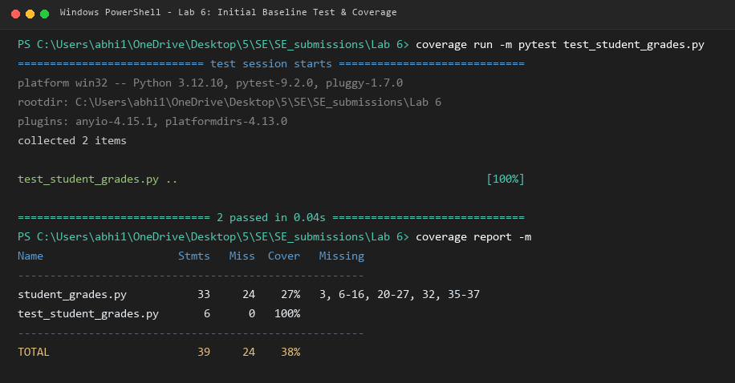
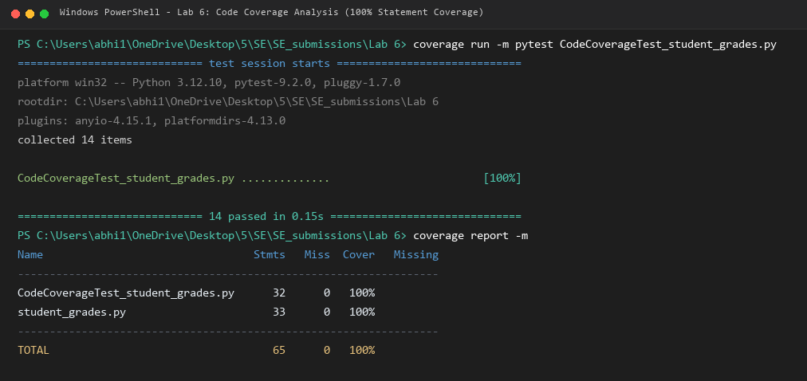
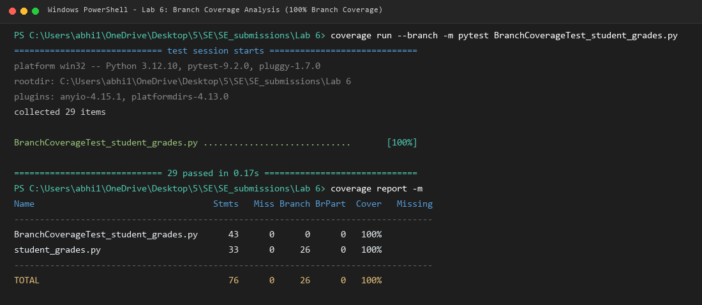

# Lab 6: Code and Branch Coverage Analysis

**Student Name**: Abhiraam Adiga  
**SRN**: PES1UG24CS015  
**Section**: A  
**Course**: Software Engineering (Fifth Semester)  
**Assigned Repository**: [SETAPESU26/L6_L7_16_student_grades](https://github.com/SETAPESU26/L6_L7_16_student_grades)  

---

## 1. Objectives

- Understand the fundamental difference between **Code (Line/Statement) Coverage** and **Branch Coverage**.
- Use Python's `coverage` tool to measure, analyze, and systematically improve test coverage.
- Interpret coverage reports and identify untested code paths, decision branches, and boundary edge cases.
- Author targeted test cases to achieve **100% code coverage** and **100% branch coverage** (exceeding the 90% requirement).
- Adhere to version control requirements with a clean multi-commit progression.

---

## 2. Software Requirements & Setup

- **Python**: 3.12.10
- **pytest**: 9.2.0
- **coverage**: 7.17.0
- **Pillow**: 12.0.0 (used for rendering high-fidelity terminal output screenshots)

Install dependencies:
```powershell
pip install -r requirements.txt
```

---

## 3. Code Coverage vs. Branch Coverage

| Coverage Type | Definition | Key Question Answered | Limitations |
|---|---|---|---|
| **Line / Statement Coverage** | Measures the percentage of executable source code statements executed by the test suite at least once. | *"Did execution pass through this line of code?"* | Can give a false sense of confidence; passes if a line is touched, even if alternative logical branches or compound conditions were never exercised. |
| **Branch Coverage** | Measures whether every control structure branch (e.g., `if`, `elif`, `else`, boolean short-circuits) evaluated to both **True** and **False**. | *"Did every decision point take every possible direction?"* | Forces testing of all logical pathways, edge boundaries, and compound conditionals. |

---

## 4. Module Under Test (`student_grades.py`)

The application module contains three core functions:

1. `letter_grade(marks)`:
   - Validates that `0 <= marks <= 100`, raising `ValueError("invalid marks")` otherwise.
   - Maps marks to grades:
     - `marks >= 90` &rarr; `"S"`
     - `marks >= 80` &rarr; `"A"`
     - `marks >= 70` &rarr; `"B"`
     - `marks >= 60` &rarr; `"C"`
     - `marks >= 50` &rarr; `"D"`
     - `marks >= 40` &rarr; `"E"`
     - `marks < 40` &rarr; `"F"`

2. `final_marks(internal, external, has_project)`:
   - Validates that `internal <= 40` and `external <= 60`, raising `ValueError("marks out of range")` otherwise.
   - Computes `total = internal + external`.
   - If `has_project` is True, adds a 5-mark project bonus (`total += 5`).
   - Caps total marks at 100 (`if total > 100: total = 100`).
   - Returns `total`.

3. `exam_eligibility(attendance, fees_paid, has_medical)`:
   - If fees are not paid (`not fees_paid`), returns `"blocked"`.
   - If `attendance >= 75`, returns `"eligible"`.
   - If `attendance >= 65 and has_medical`, returns `"eligible"`.
   - Otherwise, returns `"detained"`.

---

## 5. Phase 1: Baseline Analysis (Initial Starter State)

The repository initially came with two basic test cases in `test_student_grades.py`.

### Execution
```powershell
coverage run -m pytest test_student_grades.py
coverage report -m
```

### Initial Report Output
```text
Name                     Stmts   Miss  Cover   Missing
------------------------------------------------------
student_grades.py           33     24    27%   3, 6-16, 20-27, 32, 35-37
test_student_grades.py       6      0   100%
------------------------------------------------------
TOTAL                       39     24    38%
```

Initial line coverage was only **27%** (24 statements unreached). Running branch coverage (`coverage run --branch ...`) reported **22%** branch coverage (22 out of 26 branches missed).

### Terminal Screenshot


---

## 6. Phase 2: Code Coverage Analysis (100% Line Coverage)

### Deliverables:
- `CodeCoverageTest_student_grades.py`
- `CodeCoverageTest_student_grades_application.py`

### Test Case Design
A suite of 14 targeted test cases was created to execute every statement across all three functions:
1. `test_letter_grade_invalid_negative`: Triggers lines 2-3 (`ValueError`).
2. `test_letter_grade_s`: Triggers lines 4-5 (`"S"`).
3. `test_letter_grade_a`: Triggers lines 6-7 (`"A"`).
4. `test_letter_grade_b`: Triggers lines 8-9 (`"B"`).
5. `test_letter_grade_c`: Triggers lines 10-11 (`"C"`).
6. `test_letter_grade_d`: Triggers lines 12-13 (`"D"`).
7. `test_letter_grade_e`: Triggers lines 14-15 (`"E"`).
8. `test_letter_grade_f`: Triggers line 16 (`"F"`).
9. `test_final_marks_invalid_internal`: Triggers lines 20-21 (`ValueError`).
10. `test_final_marks_with_project_and_cap`: Triggers lines 22-27 (calculates total, executes `has_project`, executes `total > 100`, executes `total = 100`).
11. `test_exam_eligibility_fees_unpaid`: Triggers lines 31-32 (`"blocked"`).
12. `test_exam_eligibility_high_attendance`: Triggers lines 33-34 (`"eligible"`).
13. `test_exam_eligibility_medical_condonation`: Triggers lines 35-36 (`"eligible"`).
14. `test_exam_eligibility_detained`: Triggers line 37 (`"detained"`).

### Execution Command
```powershell
coverage run -m pytest CodeCoverageTest_student_grades.py
coverage report -m
```

### Code Coverage Report Output
```text
Name                                 Stmts   Miss  Cover   Missing
------------------------------------------------------------------
CodeCoverageTest_student_grades.py      32      0   100%
student_grades.py                       33      0   100%
------------------------------------------------------------------
TOTAL                                   65      0   100%
```

Achieved **100% Code Coverage** (33/33 statements executed).

### Terminal Screenshot


> [!NOTE]
> **Why 100% Code Coverage is Not Sufficient**:
> When `CodeCoverageTest_student_grades.py` was evaluated with `--branch`, branch coverage reported missing branches:
> `student_grades.py: Missing branches 23->27, 25->27`
> In `final_marks`, because `has_project=True` and `total > 100` were tested, the `has_project=False` path and the `total <= 100` path were never exercised! Similarly, `marks > 100` was never tested in `letter_grade`, and `external > 60` was never tested independently in `final_marks`.

---

## 7. Phase 3: Branch Coverage Analysis (100% Branch Coverage)

### Deliverables:
- `BranchCoverageTest_student_grades.py`
- `BranchCoverageTest_student_grades_application.py`
- `test_student_grades.py` (complete suite)

### Decision Branch Matrix & Edge Case Design

All 26 decision branches were systematically isolated and tested:

#### A. `letter_grade(marks)`
- **`marks < 0 or marks > 100`**:
  - `marks < 0` (True branch): `test_letter_grade_negative(-1)`
  - `marks > 100` (True branch): `test_letter_grade_above_max(101)`
  - Valid range (False branch): Covered by boundary tests
- **Threshold Boundaries**:
  - `marks >= 90`: Evaluated for `100` (max valid) and `90` (lower boundary of S) &rarr; `"S"`
  - `marks >= 80`: Evaluated for `89` (upper boundary of A) and `80` (lower boundary of A) &rarr; `"A"`
  - `marks >= 70`: Evaluated for `79` (upper boundary of B) and `70` (lower boundary of B) &rarr; `"B"`
  - `marks >= 60`: Evaluated for `69` (upper boundary of C) and `60` (lower boundary of C) &rarr; `"C"`
  - `marks >= 50`: Evaluated for `59` (upper boundary of D) and `50` (lower boundary of D) &rarr; `"D"`
  - `marks >= 40`: Evaluated for `49` (upper boundary of E) and `40` (lower boundary of E) &rarr; `"E"`
  - `marks < 40`: Evaluated for `39` (upper boundary of F) and `0` (lowest valid mark) &rarr; `"F"`

#### B. `final_marks(internal, external, has_project)`
- **`internal > 40 or external > 60`**:
  - `internal > 40` True, `external <= 60` False: `final_marks(41, 50, False)`
  - `internal <= 40` False, `external > 60` True: `final_marks(35, 61, False)`
  - Both True: `final_marks(45, 65, True)`
- **`if has_project:`**:
  - False branch (`23 -> 27`): `final_marks(30, 45, False) == 75`
  - True branch:
    - `total <= 100` (`25 -> 27`): `final_marks(30, 40, True) == 75`
    - `total == 100` boundary: `final_marks(40, 55, True) == 100`
    - `total > 100` (`25 -> 26`): `final_marks(40, 60, True) == 100`

#### C. `exam_eligibility(attendance, fees_paid, has_medical)`
- **`if not fees_paid:`**:
  - True branch (`31 -> 32`): `exam_eligibility(90, False, True) == "blocked"`, `exam_eligibility(50, False, False) == "blocked"`
  - False branch (`fees_paid = True`): Continues
- **`if attendance >= 75:`**:
  - True branch (`33 -> 34`): `exam_eligibility(75, True, False) == "eligible"`, `exam_eligibility(85, True, True) == "eligible"`
  - False branch (`attendance < 75`): Continues
- **`elif attendance >= 65 and has_medical:`**:
  - Both True (`35 -> 36`): `exam_eligibility(65, True, True) == "eligible"`, `exam_eligibility(70, True, True) == "eligible"`
  - First True, Second False (`35 -> 37`): `exam_eligibility(70, True, False) == "detained"`
  - First False (`attendance < 65`): `exam_eligibility(64, True, True) == "detained"`
  - Both False: `exam_eligibility(50, True, False) == "detained"`

### Execution Command
```powershell
coverage run --branch -m pytest BranchCoverageTest_student_grades.py
coverage report -m
```

### Branch Coverage Report Output
```text
Name                                   Stmts   Miss Branch BrPart  Cover   Missing
----------------------------------------------------------------------------------
BranchCoverageTest_student_grades.py      43      0      0      0   100%
student_grades.py                         33      0     26      0   100%
----------------------------------------------------------------------------------
TOTAL                                     76      0     26      0   100%
```

Achieved **100% Statement Coverage** and **100% Branch Coverage** (0 missing statements, 0 missing branches).

### Terminal Screenshot


---

## 8. Summary Comparison Matrix

| Metric | Initial Baseline | Code Coverage Suite | Branch Coverage Suite | Target / Minimum |
|---|:---:|:---:|:---:|:---:|
| **Test Cases Passed** | 2 / 2 | 14 / 14 | 29 / 29 | All passing |
| **Statement Coverage** | 27% (9/33) | **100% (33/33)** | **100% (33/33)** | &ge; 90% |
| **Statements Missed** | 24 | **0** | **0** | 0 |
| **Branch Coverage** | 22% (4/26) | 97% (24/26) | **100% (26/26)** | &ge; 90% |
| **Branches Missed** | 22 | 2 | **0** | 0 |

---

## 9. Deliverables & Evaluation Checklist

- [x] **Terminal Output Screenshots**:
  - `code_coverage_screenshot.png`: Terminal output for Code Coverage analysis (&ge; 90%).
  - `branch_coverage_screenshot.png`: Terminal output for Branch Coverage analysis (&ge; 90%).
  - `initial_coverage_screenshot.png`: Baseline terminal screenshot for completeness.
- [x] **Code Coverage Test Cases**:
  - `CodeCoverageTest_student_grades.py`
  - `CodeCoverageTest_student_grades_application.py`
- [x] **Branch Coverage Test Cases**:
  - `BranchCoverageTest_student_grades.py`
  - `BranchCoverageTest_student_grades_application.py`
- [x] **Consolidated Pytest Runner**:
  - `test_student_grades.py` (29 comprehensive tests)
- [x] **Text Reports**:
  - `code_coverage_report.txt`
  - `branch_coverage_report.txt`
  - `initial_coverage_report.txt`
- [x] **Version Control**:
  - Minimum 2 distinct commits:
    1. Commit 1: Code coverage test cases, report, and screenshot.
    2. Commit 2: Branch coverage test cases, report, screenshot, and complete documentation.
  - Pushed to `origin/main`.
